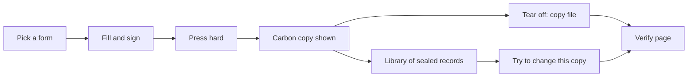

# Design Document

## Overview

`app/` is a small browser app with no framework. It has six screens and one verify page. It imports every record function from `core/`. Vite builds the app, the verify page and the two site pages into `dist/`. A service worker caches the built files so the app works offline.

## Architecture



Files:

```
app/app.config.ts            product title, the only place for the name
app/src/templates/           rental-return.ts, key-handover.ts, sold-as-seen.ts, blank.ts, sample.ts
app/src/screens/             pick.ts, fill.ts, press.ts, copy.ts, library.ts, tamper.ts
app/src/verify/              the verify page
app/src/form/                the paper form renderer, shared by fill, copy and verify
app/src/photo.ts             resize and JPEG encode
app/src/signature.ts         the signature box
app/src/stamp.ts             the press and hold control
app/src/store.ts             IndexedDB drafts and sealed records, with a memory fallback
app/src/share.ts             share sheet or download
app/src/audio.ts             sound made in code
app/src/beacon.ts            usage beacon
app/src/layout.ts            control boxes and the layout rules
app/src/sw.ts                the service worker that caches the built files
app/src/theme.css            paper, carbon blue, perforation
app/src/print.css            the print layout
app/src/assets/              paper and stamp art, original to this repository
site/index.html  site/privacy.html
e2e/                         Playwright tests, headless
```

## Components and Interfaces

```ts
export interface TemplateField { id: string; label: string; kind: 'text' | 'choice' | 'number' | 'photo'; options?: string[]; unit?: string; required: boolean }
export interface Template { id: string; title: string; fields: TemplateField[] }   // the giver and receiver name lines are added by every form and fill `parties`, not `fields`

export interface Draft { id: string; templateId: string; record: HandoverRecord; updatedAt: number }
export interface Store {
  saveDraft(draft: Draft): Promise<void>;
  listDrafts(): Promise<Draft[]>;
  saveSealed(record: HandoverRecord): Promise<void>;
  listSealed(): Promise<{ seal: string; title: string; sealedAt: string }[]>;
  getSealed(seal: string): Promise<HandoverRecord | null>;
  deleteSealed(seal: string): Promise<void>;
  persistent: boolean;          // false when the memory fallback is in use
}

export function createStamp(element: HTMLElement, options: { holdMs: number; onSeal(): void; reducedMotion: boolean }): { destroy(): void };
export function resizePhoto(file: Blob, maxSide: number, maxBase64Length: number):
  Promise<{ ok: true; dataBase64: string; width: number; height: number } | { ok: false; error: 'unreadable' | 'too_big' }>;
export function createSignatureBox(element: HTMLElement): { strokes(): number[][]; clear(): void; isEmpty(): boolean };
```

- The stamp uses pointer events and key events. Progress is `elapsed / holdMs`, drawn as a meter. `onSeal` is called once when progress reaches 1. A `pointerup`, `pointercancel`, a lost focus or a `keyup` is a release. Repeated `keydown` events from a held key are ignored. The caller of `onSeal` reads the device clock and calls `sealRecord`.
- A photo gets its `digest` from `sha256Hex` of the bytes of `atob(dataBase64)`, both from `core/`. `resizePhoto` tries quality 0.82, then 0.7, then 0.6, and returns `too_big` when the base64 text is still longer than `maxBase64Length` (1,500,000). The size shown on the photo line is `dataBase64.length * 3 / 4`, rounded, in KB.
- The form renderer takes a record and a mode: `edit`, `top` or `carbon`. The `carbon` mode uses the carbon blue ink colour. The same renderer feeds the print layout. Every control and the root of every screen carry `data-control` and `data-screen`, so the layout test can name the screen and the control.
- The verify page reads files with `File.text()`, then `parseCopyFile`. It never inserts file content as HTML. Typed seal words are compared with `sealWords(record.seal)`. A typed full seal goes to `verifyRecord` as the expected seal. A difference from `diffRecords` is placed on a line when its path is `fields.<id>.value` or `fields.<id>.label`. Every other path is listed under the form.
- `Try to change this copy` copies the sealed record in memory, lets the user edit the value of one field in the copy, then runs `verifyRecord` on the duplicate (it keeps the original seal, so the result is `changed`) and `diffRecords` against the original to mark the line. The stored record is never written.
- Text inputs have `maxlength` 500. The signature box ignores points after the 4000th.

## Data Models

- IndexedDB database `counter`, version 1, with stores `drafts` (key `id`) and `sealed` (key `seal`).
- Photo JPEG quality steps are in the list above. The photo limit is 1,500,000 base64 characters and the photo count limit is 6.
- Signature points are scaled to integers from 0 to 1000 inside the box, x by the box width and y by the box height, rounded and clamped, with a new stroke for each pointer down.
- Beacon body: `{ "event": "sealed", "template": "rental-return" }`. Nothing else is sent. A template id that is not one of the four forms is sent as `other`.
- The product name is read from `app/app.config.ts` by the app, the site pages (at build time) and the title option of `buildCopyFile`. No other file holds it.

## Error Handling

- Storage errors switch to the memory store and show the one time notice. Sealing and tear off still work.
- A photo that cannot be decoded shows `This photo could not be read` on its line and adds nothing.
- A share that the user cancels is not an error. A share that fails falls back to download.
- When `sealRecord` returns problems, nothing is sealed or stored, and one line names the first problem.
- The verify page shows one plain line for each `parseCopyFile` error code, and `This copy has no seal` for the `unsealed` result.

## Testing Strategy

Tests are written first and seen to fail.

- Unit tests with Vitest and a DOM test environment: templates are valid, the stamp with a fake timer (1199 ms does not seal, 1200 ms seals once, the meter reads 0.5 at 600 ms, and a held key with repeated `keydown` events seals once), the signature scaling (box 200 by 100 px: point (0,0) gives (0,0), (100,50) gives (500,500), (150,25) gives (750,250), (200,100) gives (1000,1000), and (-5,120) is clamped to (0,1000); two pointer downs give two strokes; the 4001st point is ignored), the lock rule, the blank form limit of 12 lines, the file name rule, the share fallback, the typed seal words and full seal on the verify page, the store with a fake IndexedDB and with storage blocked, the beacon with and without the variable.
- Photo test in the good path test, in a real browser because the DOM test environment has no canvas: a 4000 by 3000 image comes out 1600 by 1200 (the scale is 1600 / 4000 = 0.4, and 3000 × 0.4 = 1200).
- Playwright tests in `e2e/`, headless: `layout.spec.ts` (real boxes from `getBoundingClientRect` for every element with `data-control`, at the 7 sizes, naming `data-screen` and the control), `contrast.spec.ts` (body text against its background, ratio 4.5 or more, from computed colours), `good-path.spec.ts`, `bad-path.spec.ts`, and `print.spec.ts` (the print layout as PDF in A4 and in Letter has the seal words on every page, and each photo has `break-inside: avoid`). Good path and bad path also record every request and fail on any request to another origin.
- The good path test holds the stamp with a real pointer down, a wait of 1300 ms and a pointer up. It then reads the downloaded file, loads it into the verify page, and opens it from disk to read the `stamp` element. The bad path test holds the stamp for 800 ms, releases it, waits 600 ms more (1400 ms in all, past the 1200 ms hold) and checks that nothing is sealed.

## Correctness Properties

1. **Sealed means unchanged.** For any sequence of user actions after sealing, the sealed record in the store has the same seal and `verifyRecord` returns `matches`. (Requirements 4.3, 4.4)
2. **Early release seals nothing.** For any hold shorter than 1200 ms, no record is sealed and no sealed record is stored. (3.2)
3. **The copy equals the top.** For any sealed record, the record parsed from the torn off file has the same canonical text as the top copy in the store. (4.1)
4. **A changed duplicate is caught.** For any sealed record and any edit of one line in the duplicate, the verify result is `changed` and the marked line is the edited one. (6.1, 6.2)
5. **Controls fit.** For every screen and every listed viewport, the layout check returns no problem. (8.1)
6. **Limits hold.** For any input the user can make, the record the app builds is accepted by `validateRecord` or the app refuses the input in one line. (2.3, 2.6, 3.6)

## Decisions and Alternatives

- Press and hold over a tap. Chosen because the hold is the product's moment, it prevents an accidental seal, and it matches "press hard" on a paper form.
- Plain DOM over a framework. Chosen to keep the app small and the licence list short.
- One device for both signatures. Chosen because it needs no network between two phones, like the paper form.
- The verify page reads files as text. Chosen so that a hostile file cannot run code in the page.

## Out of Scope

- Accounts, sync, and sending a copy by the app itself.
- A form builder beyond the blank form.
- Reading a QR code or a paper form.
- Translations.
