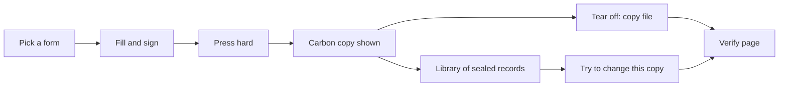

# Design Document

## Overview

`app/` is a small browser app with no framework. It has five screens and one verify page. It imports every record function from `core/`. Vite builds the app, the verify page and the two site pages into `dist/`. A service worker caches the built files so the app works offline.

## Architecture



Files:

```
app/app.config.ts            product title, the only place for the name
app/src/templates/           rental-return.ts, key-handover.ts, sold-as-seen.ts, blank.ts, sample.ts
app/src/screens/             pick.ts, fill.ts, press.ts, copy.ts, library.ts
app/src/verify/              the verify page
app/src/form/                the paper form renderer, shared by fill, copy and verify
app/src/photo.ts             resize and JPEG encode
app/src/signature.ts         the signature box
app/src/stamp.ts             the press and hold control
app/src/store.ts             IndexedDB drafts and sealed records, with a memory fallback
app/src/share.ts             share sheet or download
app/src/audio.ts             sound made in code
app/src/beacon.ts            usage beacon
app/src/layout.ts            control boxes and the layout rules
app/src/theme.css            paper, carbon blue, perforation
site/index.html  site/privacy.html
e2e/                         Playwright tests, headless
```

## Components and Interfaces

```ts
export interface TemplateField { id: string; label: string; kind: 'text' | 'choice' | 'number' | 'photo'; options?: string[]; unit?: string; required: boolean }
export interface Template { id: string; title: string; fields: TemplateField[] }

export interface Draft { id: string; templateId: string; record: HandoverRecord; updatedAt: number }
export interface Store {
  saveDraft(draft: Draft): Promise<void>;
  listDrafts(): Promise<Draft[]>;
  saveSealed(record: HandoverRecord): Promise<void>;
  listSealed(): Promise<{ seal: string; title: string; sealedAt: string }[]>;
  getSealed(seal: string): Promise<HandoverRecord | null>;
  deleteSealed(seal: string): Promise<void>;
  persistent: boolean;          // false when the memory fallback is in use
}

export function createStamp(element: HTMLElement, options: { holdMs: number; onSeal(): void; reducedMotion: boolean }): { destroy(): void };
export function resizePhoto(file: Blob, maxSide: number, quality: number): Promise<{ dataBase64: string; width: number; height: number }>;
export function createSignatureBox(element: HTMLElement): { strokes(): number[][]; clear(): void; isEmpty(): boolean };
```

- The stamp uses pointer events and key events. Progress is `elapsed / holdMs`, drawn as a meter. `onSeal` is called once when progress reaches 1.
- The form renderer takes a record and a mode: `edit`, `top` or `carbon`. The `carbon` mode uses the carbon blue ink colour. The same renderer feeds the print layout.
- The verify page reads files with `File.text()`, then `parseCopyFile`. It never inserts file content as HTML.

## Data Models

- IndexedDB database `counter`, version 1, with stores `drafts` (key `id`) and `sealed` (key `seal`).
- Photo JPEG quality starts at 0.82. If the result is over the limit, the app retries at 0.7 and then 0.6 before it refuses.
- Signature points are scaled to integers from 0 to 1000 inside the box, with a new stroke for each pointer down.
- Beacon body: `{ "event": "sealed", "template": "rental-return" }`. Nothing else is sent.

## Error Handling

- Storage errors switch to the memory store and show the one time notice. Sealing and tear off still work.
- A photo that cannot be decoded shows `This photo could not be read` on its line and adds nothing.
- A share that the user cancels is not an error. A share that fails falls back to download.
- The verify page shows one plain line for each `parseCopyFile` error code.

## Testing Strategy

Tests are written first and seen to fail.

- Unit tests with Vitest and a DOM test environment: templates are valid, the stamp with a fake timer (1199 ms does not seal, 1200 ms seals once), the signature scaling, the store with a fake IndexedDB and with storage blocked, the beacon with and without the variable.
- Photo test in the browser test run: a 4000 by 3000 image comes out with a longer side of 1600.
- Playwright tests in `e2e/`, headless: `layout.spec.ts` (real boxes from `getBoundingClientRect` for every element with `data-control`, at the 7 sizes), `good-path.spec.ts`, `bad-path.spec.ts`, and `print.spec.ts` (the print layout as PDF has the seal words on every page).
- The good path test holds the stamp with a real pointer down, a wait of 1300 ms and a pointer up. It then reads the downloaded file and loads it into the verify page.

## Correctness Properties

1. **Sealed means unchanged.** For any sequence of user actions after sealing, the sealed record in the store has the same seal and `verifyRecord` returns `matches`. (Requirements 4.3, 4.4)
2. **Early release seals nothing.** For any hold shorter than 1200 ms, no record is sealed and no sealed record is stored. (3.2)
3. **The copy equals the top.** For any sealed record, the record parsed from the torn off file has the same canonical text as the top copy in the store. (4.1)
4. **A changed duplicate is caught.** For any sealed record and any edit of one line in the duplicate, the verify result is `changed` and the marked line is the edited one. (6.1, 6.2)
5. **Controls fit.** For every screen and every listed viewport, the layout check returns no problem. (8.1)

## Decisions and Alternatives

- Press and hold over a tap. Chosen because the hold is the product's moment, it prevents an accidental seal, and it matches "press hard" on a paper form.
- Plain DOM over a framework. Chosen to keep the app small and the licence list short.
- One device for both signatures. Chosen because it needs no network between two phones, like the paper form.
- The verify page reads files as text. Chosen so that a hostile file cannot run code in the page.

## Out of Scope

- Accounts, sync, and sending a copy by the app itself.
- A form builder beyond the blank form.
- Reading a QR code or a paper form.
- Translations.
