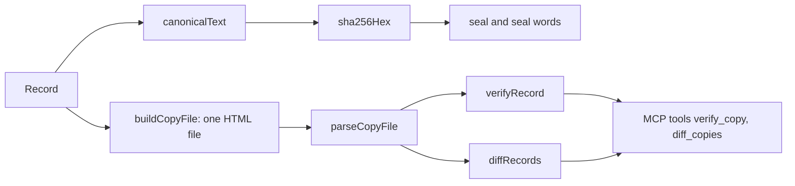

# Design Document

## Overview

`core/` is a TypeScript package with no dependencies and no access to the DOM, storage, network or clock. `mcp/` is a thin server over `core/` that reads copy files from disk. The form app imports `core/` and never repeats its logic.

Both packages are private ES module packages named `core` and `mcp`, version `0.1.0`. `core` builds with `tsc` to `core/dist/`, and its `package.json` points `exports` at `dist/index.js`. The `build` script of `mcp` builds `core` first and then compiles `mcp/src` to `mcp/dist/`. Imports inside a package use the `.js` ending. `dist/` is not committed.

## Architecture



Files:

```
core/src/types.ts       the record types
core/src/validate.ts    validateRecord
core/src/canonical.ts   canonicalText
core/src/sha256.ts      sha256Hex
core/src/words.ts       the 256 words, sealWords
core/src/seal.ts        sealRecord, verifyRecord
core/src/copyfile.ts    buildCopyFile, parseCopyFile
core/src/diff.ts        diffRecords
core/src/index.ts       the only export file
core/src/generated/     check-script.ts, written by core/scripts/gen-check.ts, not committed
core/scripts/gen-check.ts   builds the inline check script text from sha256.ts and canonical.ts
core/tests/             all core tests, named as in Testing Strategy
core/tests/fixtures/    fixture records as JSON, unsealed, with sealedAt null
mcp/src/server.ts       MCP wiring
mcp/src/tools.ts        the two handlers as plain functions
mcp/tests/              tool tests and the process test
mcp/scripts/make-demo-copies.ts   writes the two demo copy files to mcp/demo/, not committed
```

## Components and Interfaces

```ts
export type FieldKind = 'text' | 'choice' | 'number' | 'photo';
export interface Field {
  id: string;                 // lower case letters, digits and '-', unique in the record
  label: string;
  kind: FieldKind;
  value: string | null;       // text, the chosen option, a number as text with at most 3 decimal places, or null (always null for kind 'photo')
  unit?: string;              // for kind 'number'
  options?: string[];         // for kind 'choice'
  photoDigest?: string;       // for kind 'photo': the sha256 of the photo bytes
}
export interface Photo { digest: string; mime: 'image/jpeg'; width: number; height: number; dataBase64: string }
export interface Signature { party: 'giver' | 'receiver'; strokes: number[][] } // each stroke is x0,y0,x1,y1,... with integers 0 to 1000; a point is one x,y pair
export interface HandoverRecord {
  format: 1;
  form: { templateId: string; title: string };
  sealedAt: string | null;    // ISO 8601 text, set when sealed
  parties: { giver: string; receiver: string };
  fields: Field[];
  photos: Photo[];
  signatures: Signature[];    // at most one for each party
  seal?: string;              // 64 lower case hex characters
}

export function validateRecord(value: unknown): string[];
export function canonicalText(record: HandoverRecord): string;        // leaves out the seal key
export function sha256Hex(bytes: Uint8Array): string;
export function sealWords(seal: string): string;
export function sealRecord(record: HandoverRecord, sealedAt: string):
  { ok: true; record: HandoverRecord } | { ok: false; problems: string[] };
export type VerifyResult = 'matches' | 'changed' | 'unsealed' | 'wrong_seal';
export function verifyRecord(record: HandoverRecord, expectedSeal?: string): VerifyResult;
export function buildCopyFile(record: HandoverRecord, options: { title: string; paper: 'top' | 'carbon' }): string;
export function parseCopyFile(text: string):
  { ok: true; record: HandoverRecord } | { ok: false; error: 'no_record' | 'bad_json' | 'bad_record'; problems?: string[] };
export interface Difference { path: string; a: string | null; b: string | null }
export function diffRecords(a: HandoverRecord, b: HandoverRecord): Difference[];
```

Tool server:

| Tool | Input | Output |
| --- | --- | --- |
| `verify_copy` | `{ path: string, expectedSeal?: string }` | `{ result, seal, sealWords, sealedAt, title, giver, receiver, photos }`. `seal`, `sealWords` and `sealedAt` are null when the copy is unsealed. `photos` is a count. |
| `diff_copies` | `{ pathA: string, pathB: string }` | `{ equal: boolean, differences: Difference[] }` |

Error codes: `bad_args` (a path is missing from the call), `not_found`, `not_a_file`, `too_large`, `no_record`, `bad_json`, `bad_record`.

## Data Models

- Canonical text: keys sorted by code unit order, no spaces, strings with `JSON.stringify`, numbers with `String(n)`, `null` as `null`. Keys whose value is `undefined` are skipped. The top level `seal` key is skipped.
- The seal is `sha256Hex` of the UTF-8 bytes of the canonical text, taken with `TextEncoder`.
- A photo's `digest` is `sha256Hex` of the decoded image bytes. The bytes come from `atob`, which exists in browsers and in Node 18 and later. `validateRecord` checks the digest.
- Seal words: byte i of the seal (i from 0 to 3) picks word number `byte` from the list.
- Copy file layout: a `main` element with the form as plain HTML and inline CSS, the seal words and the full seal, an element with id `stamp` that holds the check result, one `img` for each photo with a `data:` URL, one inline SVG for each signature, then `<script id="record" type="application/json">`, then the inline check script. All text taken from the record is HTML escaped in the body, so the record element is the only one with that id.
- The check script is generated by `core/scripts/gen-check.ts` from `sha256.ts` and `canonical.ts`, so the logic exists once in source. The part that reads the record element and writes the `stamp` text is a fixed string in `copyfile.ts`. The generator runs before every core test and build (the `pretest` and `prebuild` scripts of `core`).
- `parseCopyFile` takes the text between the first `<script id="record" type="application/json">` and the next `</script>`. This is safe because every `<` in the JSON is written as `\u003c`. It then runs `JSON.parse` and `validateRecord`.
- `diffRecords` compares in this order and reports each difference as `{ path, a, b }`. A value is text, or null when the item is not there.
  - `format` and `form.templateId` and `form.title`, `sealedAt`, `parties.giver`, `parties.receiver`: the value on each side.
  - Fields are matched by id. `fields.<id>` when the id is on one side only (the value is the canonical text of the field). When on both sides: `fields.<id>.value`, `.label`, `.kind`, `.unit`, `.options` and `.photoDigest`, each only when it differs (`options` as canonical text).
  - `fields.order` when both sides have the same ids in a different order (the ids joined with `,`).
  - Photos are matched by digest. `photos.<digest>` when on one side only (the value is the digest). When on both sides: `photos.<digest>.mime`, `.width`, `.height` and `.dataBase64`, each only when it differs. For `.dataBase64` the value is the SHA-256 of the text, never the image data. `photos.order` when the same digests come in a different order.
  - Signatures are matched by party. `signatures.<party>` when it differs or is on one side only. The value is the SHA-256 of the canonical text of the strokes. `signatures.order` when the parties come in a different order.
  - The `seal` key is not compared, as in the canonical text.

## Error Handling

- Every function that takes outside input returns a typed result. None of them throws for bad input.
- `sha256Hex` and `canonicalText` throw only when called with a value of the wrong type from our own code.
- The tool server catches any thrown error, returns an error result, and writes the stack to standard error. It writes nothing else to standard output than MCP messages.

## Testing Strategy

Tests are written first and seen to fail. The ESLint block for `core/` covers `core/src/` only. Tests may use Node's `crypto`.

- `sha256.test.ts`: the two known values from requirement 3.2, the value for one million `a` characters from the public SHA-256 test vectors (`cdc76e5c9914fb9281a1c7e284d73e67f1809a48a497200e046d39ccc7112cd0`), inputs of length 0, 1, 55, 56, 63, 64, 65, 119, 120 and 128 (the edges of the 64 byte block and the 8 byte length field) against Node's `crypto`, and 300 random inputs of 0 to 5000 bytes against Node's `crypto`.
- `canonical.test.ts`: key order, nested arrays, the skipped seal key, a skipped `undefined` key.
- `validate.test.ts`: for each limit in requirement 1.3, one record exactly at the limit that has no problem and one record one over the limit that has a problem. The 1,500,000 character photo is made in the test from 1,125,000 bytes (1,500,000 / 4 × 3), with its real digest. One test for each refusal in requirements 1.4 and 1.5.
- `seal.test.ts`: fixture `rental-return.json` seals and verifies as `matches`. Changing one character of one field gives `changed`. Sealing twice is refused. A record with no seal gives `unsealed`, also when an expected seal is given. A good record with another expected seal gives `wrong_seal`. A changed record with another expected seal gives `changed`.
- `words.test.ts`: 256 different words of 3 to 6 letters, and the same seal always gives the same words.
- `copyfile.test.ts`: build then parse gives a record with the same canonical text. A record whose text value is `</script><b>x` builds a file that still parses to the same record. The file text holds no `http://`, `https://` or `@import`, no `<link` element, no `src`, `href` or `url(` value that is not a `data:` URL or starts with `#`, and no `<script src`. The text `//` is not searched for, because base64 photo data can hold it. A record with a bad record element gives `bad_record`. The inline check script is run in Node with a small fake `document` for a good file and for a file with one changed character, and the `stamp` text is read.
- The check of the same file in a real browser is not in this spec. The `counter-app` spec runs it (its task 9). Until it has run, requirement 5.4 is checked only with the fake `document`.
- `diff.test.ts`: one changed field, one removed photo, one changed signature point, a changed `form.templateId`, two fields in another order, a changed photo `width`, and equal records.
- Tool tests call `tools.ts` directly with temporary files, check that no file is written, then one process test lists the two tools.

## Correctness Properties

1. **Key order does not matter.** For any record, shuffling the key order of every object gives the same seal. (Requirements 2.1, 2.2)
2. **Any change breaks the seal.** For any sealed record and any single change to a field value, a label, a party name, a photo byte or a signature point, `verifyRecord` returns `changed`. (4.1, 6.1)
3. **Copy file round trip.** For any valid sealed record, `parseCopyFile(buildCopyFile(r, options))` returns a record with the same canonical text and `verifyRecord` returns `matches`. (5.1, 5.5)
4. **Own SHA-256 equals the platform's.** For any byte array of 0 to 5000 bytes, `sha256Hex` equals Node's `crypto` result. (3.3)
5. **Script safety.** For any text value, including one that holds `</script>`, the built copy file has exactly one element with id `record` and parses back to the same value. (5.2)
6. **Diff is exact.** `diffRecords(a, b)` is empty exactly when the canonical texts are equal, and for a single field value change it has exactly one entry with the path `fields.<id>.value`. (6.3, 6.4)
7. **Words follow the seal.** Two seals with the same first four bytes give the same words, and seals that differ in one of those bytes give different words. (4.3)

## Decisions and Alternatives

- One HTML file over a zip or a JSON file. Chosen because it opens anywhere with no app. The verify page on the site also accepts it.
- An own SHA-256 inside the copy file. Chosen because a page opened from disk cannot rely on the browser's crypto API in every browser.
- Four words over a QR code. Chosen because two people can compare words by voice, and it needs no camera and no library.
- Stroke points over signature images. Chosen so that the seal does not depend on how a browser encodes an image.
- A generated check script over `Function.prototype.toString`. Chosen because the test runner and the compiler rewrite function bodies, so their text is not stable.

## Out of Scope

- Identity checks, accounts, time stamping by a third party, and encryption of the copy file.
- Any server.
- Editing a record after sealing. A correction is a new record.
