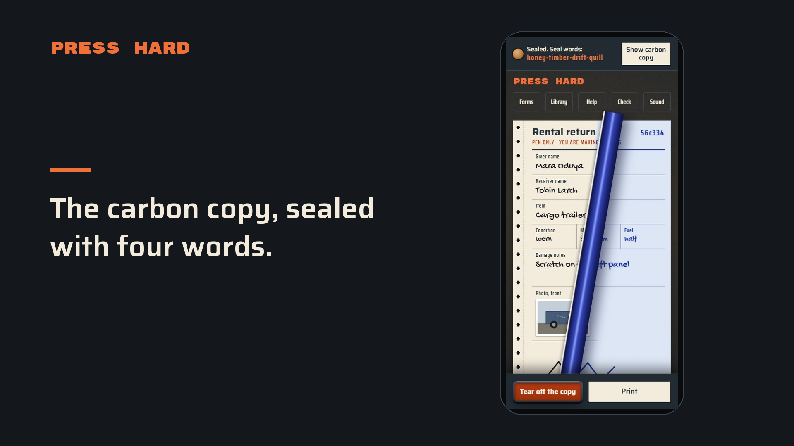
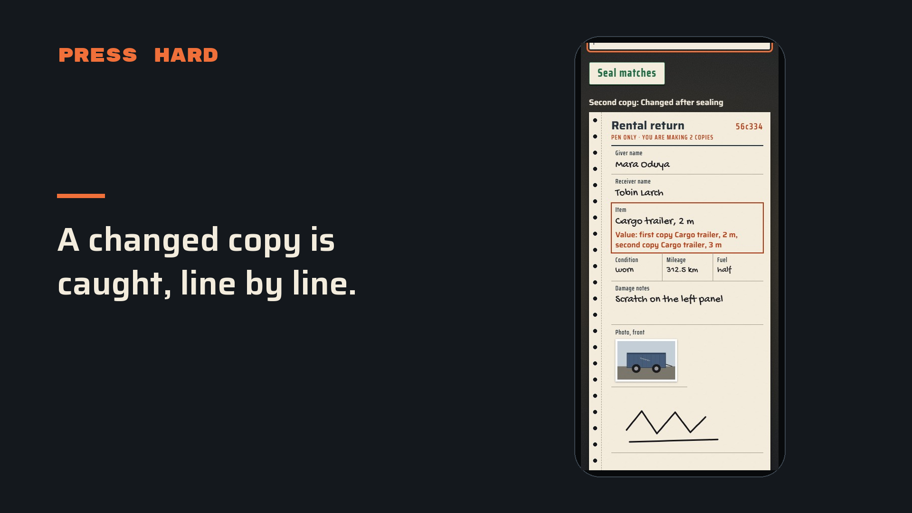

# Press Hard



Live app: https://press-hard.midknight-ent-llc.workers.dev | Video: https://youtu.be/Xl3lRyM_yCI

Press Hard is our entry in the Resurrection category: "Bring your favorite dead technology back to life. Reimagine obsolete tech with today's innovations." Our dead technology is the carbon copy form. Two people fill one handover form on one phone, both sign, and press and hold a stamp. Each person keeps the same sealed copy, one small file. Today's innovations do the rest: a SHA-256 seal shown as four plain words, a check that marks the changed line in a changed copy, and an app that works offline with no account and no server. Kiro built it, and every Kiro tool named in the rules has a saved proof in this repository: six specs, four steering files, two agent hooks, a custom MCP server, a power, a custom agent and 26 properties checked by property based testing. The code was written in the Kiro CLI. The Kiro IDE, Kiro Web and Kiro Crew were each used for real work too.

Category: Resurrection. Built with Kiro CLI, IDE, Web and Crew: six specs, four steering files, two hooks, a power, a custom agent, a custom MCP server and 26 property tests.

## Judging criteria at a glance

**Potential Impact.** Small rental shops and anyone who hands over an item or a key still use paper duplicate books, or nothing. In a 2025 report on 1,710 rental car damage claims, 58% of the claims for structural damage were not caused by the renter (CarInsuRent 2025 Rental Car Insurance Report, as reported by Repairer Driven News on 3 March 2026). Press Hard gives both sides the same dated record of the item at handover, on one phone, with no account, no login and no server. It works offline after the first load. A record never leaves the device unless the person shares the copy file. An automated axe scan of every screen at a phone size and a desktop size finds no serious or critical violation (see the Accessibility section below).

**Technological Implementation.** Kiro wrote the code, and each Kiro tool of the judges' list was used, with a saved proof for each. Kiro CLI wrote the app test first from two specs (`record-core`, `counter-app`) and later added a power (`power/press-hard`) and a custom agent (`copy-checker`, no write and no shell tool), both run headless (`docs/acceptance/power-session/`, `docs/acceptance/copy-checker-session/`). Kiro IDE ran three spec tasks from their Start task links (`docs/acceptance/ide-session/`). Kiro Web made a pull request that was merged (`docs/acceptance/kiro-web-session/`). A Kiro Crew app, `press-hard-crew`, gives a Crew agent the same two copycheck tools (https://github.com/Midknight56/press-hard-crew). Two agent hooks ran: `verify-on-stop` in the CLI and the IDE, and `typecheck-on-save` in the IDE (`docs/acceptance/hook-verify-on-stop.md`). Four steering files, a custom MCP server (`copycheck`) and 26 property tests complete the list. Two experiments compare Kiro's ways of working: one feature built from a loose prompt and from a spec (`docs/acceptance/vibe-vs-spec/`), and one spec task run on three models (`docs/acceptance/model-test/`), with the credits of each run.

**Design.** A complete product, not a proof of concept: pick a form, fill it, add photos, sign, press and hold the stamp, tear off the copy, keep a library, check any copy later, print it. An automatic layout test measures every screen at 7 sizes from 360 by 640 to 1920 by 1080 (16 px edges, 44 px controls, 12 px gaps), and a contrast test checks every text at 4.5 or more. The stamp, paper, torn edge and icon are hand drawn SVG in the form's own palette.

**Innovation/Idea.** It brings back the carbon paper duplicate book and keeps its best part: both people hold the same record. The new part is the seal. The copy is one HTML file with a SHA-256 seal shown as four plain words, so two people can compare copies by reading four words aloud.

**Presentation.** The video shows the whole flow on a phone: fill, press hard, the carbon copy appears, tear off, four words, then a changed copy is caught with the changed line marked. The last part shows how Kiro built it: the specs, the steering files, the hooks, the copycheck MCP server, the property tests and the log of all 36 runs.

## How it works

1. Pick a form: rental return, key handover, item sold as seen, tool loan, or a blank form.
2. Fill it. Add up to 6 photos. Both people sign.
3. Press and hold the stamp. The record is sealed.
4. Tear off the copy. It is one HTML file. The seal is shown as four words.
5. Later, anyone can check a copy at the verify page. A changed copy no longer matches its seal, and the changed line is shown.



## Run it

Node 24.

```bash
npm install
npm run verify
npm run verify:e2e
npm run build
```

`verify` runs the type check, lint and unit tests. `verify:e2e` adds the browser tests, headless. `build` writes the site, the app and the verify page to `dist/`.

## Tests on the last full run

| Suite | Tests | Result |
| --- | --- | --- |
| core: record, seal, copy file, compare, README and steering checks | 263 | pass |
| mcp: copycheck server | 31 | pass |
| app: screens, store, art | 439 | pass |
| browser: good path, bad path, layout, carbon copy, carbon copy reveal, fonts and look, contrast, print, offline, site, words on screen, sub path, accessibility scan | 64 | pass |

## Accessibility

An automated axe scan (`axe-core` 4.14.1, through `@axe-core/playwright` 4.14.0) runs on every screen at 390 by 844 and at 1280 by 720 and fails the build on any serious or critical violation. It scanned 18 screens at each size, 36 scans in all. Before the fixes it found 30 violations (a rule on a screen) on 74 elements, 20 of them serious or critical. After the fixes it finds none. An automated scan does not prove that a product is accessible to every person. To run the scan alone, use `npm run a11y`.

## How Kiro was used

**Kiro IDE, CLI, Web, Crew.** All four were used, and they differed.
- CLI: Kiro CLI 3.3.0 wrote the first build, one headless run for each task (36 runs, all in `docs/kiro-log.md`). Kiro CLI 3.5.0 wrote the power, the agent, the accessibility scan and the Tool loan form. Headless runs ask for nothing, and a hook's output comes back to the session as text.
- IDE: three spec tasks ran from the `Start task` links of `tasks.md`. The IDE asked for approval for each shell command (11 approvals), started the hooks switched off, and showed each hook run as a `Run Command Hook` row. It fixed the steering so that it names all five forms (`docs/acceptance/ide-session/`).
- Web: Kiro Web made pull request 1 from its cloud workspace (an `npm run a11y` script). Its network was limited to the repository, so `npm ci` failed with a 403 and no test suite ran there. It said so, and the checks were run here after the merge (`docs/acceptance/kiro-web-session/`).
- Crew: the Crew app `press-hard-crew` (https://github.com/Midknight56/press-hard-crew) was written by Kiro, installed and enabled in Kiro Crew 0.12.2, and run once. Its agent called `verify_copy` on each of two copies and `diff_copies`, and named `fields.mileage.value`, 48210.5 against 12.5. Crew needed the app named in two trust lists, and a run waits for approval, which a script gave for that one run. The README of the app holds the transcript and the install steps as they were seen.

**Custom agents.** `copy-checker` (`.kiro/agents/copy-checker.json`) is a custom agent with file reads and the two copycheck tools only, no write tool and no shell tool. It validates (`kiro-cli agent validate`), and a headless run in the Kiro CLI checked a good copy and a changed copy and named the changed line, `fields.mileage.value`, 48210.5 against 12.5. A second run asked it to write a file and run a shell command, and it refused. A test checks that every tool it names exists. The copycheck tools did not always load: with the file read tool named `read`, 2 of 5 runs loaded them, and with `fs_read`, 6 of 7. When they did not load, the agent said so and made no call, so it never guessed. The counts and the open cause are in `docs/acceptance/copy-checker-session/`.

**Agent hooks.** Two hooks live in `.kiro/hooks/`: `npm run typecheck` on each TypeScript save, and the full `npm run verify` when the agent finishes a turn. `verify-on-stop` fired in headless Kiro CLI 3.5.0 sessions and in the IDE, at the end of each turn. In one session it reported two failing proof cases and the agent left the tests alone. `typecheck-on-save` fired in the IDE when the agent saved a TypeScript file with its edit tool. It did not fire when the agent wrote the file with a shell command, and it was not seen in the CLI. Proof: `docs/acceptance/hook-verify-on-stop.md` and `docs/acceptance/ide-session/`.

**Spec driven development.** Six specs, each in three files: `requirements.md` (user stories with acceptance criteria), `design.md` and `tasks.md`. `record-core` is the record, the seal and the copy file. `counter-app` is every screen. `kiro-extensions` is the power and the agent. `accessibility-scan` is the axe scan. `tool-loan-form` and `steering-forms` are two small features. Each task went test first, and each log row records the failing test, the passing run and the files. We built the Tool loan form twice from the same idea: from one loose sentence, and from a short spec. Both passed the full check. The loose build took 3 min 13 s and 2.39 credits, and it left the privacy page saying "four forms" while the app had five. The spec build took 4 min 1 s and 2.99 credits (1.60 more to write the spec), added browser steps, and fixed the privacy page. See `docs/acceptance/vibe-vs-spec/`. One feature, one run of each.

**Steering docs.** `product.md` holds the flow, the words to use and never use, and the limits. `record-rules.md` holds the record format and the seal. `ui-standards.md` holds edges, sizes and contrast. `claims-policy.md` holds what the product may claim. The words rule made the biggest difference: the app never says "tamper proof" or "secure"; it says "a changed copy no longer matches the seal", and a test checks for the banned words. When the fifth form was added, the steering still said four forms, so a test now fails when `product.md` does not name every form (`core/tests/steering-forms.test.ts`, made in the IDE).

**MCP.** The `copycheck` server (`mcp/src/server.ts`) gives Kiro two tools. Kiro used them in the CLI, in a power, in the custom agent, in the IDE (listed as connected with 2 tools) and in the Crew app. With them Kiro checked a real copy file and a changed one, and named the changed field: `fields.mileage.value`, 48210.5 changed to 12.5. The calls are in `docs/kiro-log.md` and the session folders of `docs/acceptance/`.

**Property based testing (PBT).** 26 properties: 7 from the design and 19 derived from the requirements. They cover the copy file round trip, the seal changing when any field changes, the seal words, the canonical text, the record limits and the compare. No property found a bug in the finished code. To prove they can fail, two faults were put in by hand and then removed: dropping the key sort in the canonical text failed property 1, and a broken value compare failed property 6.

**Kiro powers.** `power/press-hard` is a Kiro power in the Agent Plugins format. It packs the `copycheck` tools and a skill, `handover-records`, with the rules for checking a copy. It was installed with `kiro-cli powers install`, one headless session used it from a plain question and called `verify_copy` twice and `diff_copies` once, then it was uninstalled (`docs/acceptance/power-session/`).

**Model test.** The same spec task ran on Auto, `claude-sonnet-5.5` and `gpt-5.6-luna`. All three passed the full check. They took 4 min 1 s, 7 min 48 s and 17 min 34 s, and used 2.99, 10.00 and 6.54 credits (read from Kiro's session files). `docs/acceptance/model-test/` has the table.

## Licence

MIT for the code. Code, drawings and sounds are original work made for it. The fonts are Gochi Hand, Rubik Mono One, Saira and Saira Condensed, bundled in app/src/fonts under the SIL Open Font Licence, with the licence texts beside them.
